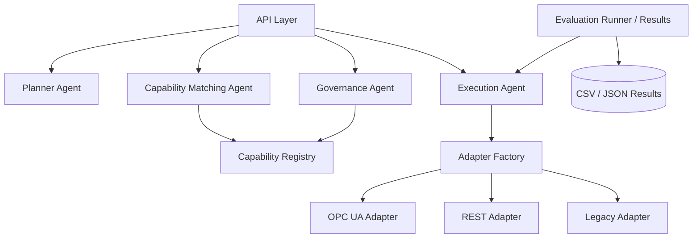

# Architecture Diagram

The architecture uses a FastAPI layer for manual testing and inspection.
Planning, matching, governance, and execution are implemented as separate
deterministic agents. The capability registry provides adapter metadata and
policy tags. The execution agent invokes mock adapters through the adapter
factory only after governance decisions have been applied. The evaluation runner
uses the same execution path and exports structured CSV and JSON results.
