# Workflow Diagram

```mermaid
flowchart LR
    Goal[Goal] --> Planner[Planner Agent]
    Planner --> Plan[Plan]
    Plan --> Matcher[Capability Matching Agent]
    Matcher --> MappedPlan[Mapped Plan]
    MappedPlan --> Governance[Governance Agent]
    Governance --> GovernedPlan[Governance Evaluation]
    GovernedPlan --> Execution[Execution Agent]
    Execution --> Result[Execution Result]
```

The workflow separates the supervisory process into explicit stages. A goal is
planned, mapped to registered capabilities, evaluated by deterministic
governance rules, and then executed only when policy allows. The result records
adapter outputs, skipped steps, blocked steps, approval-required steps, and
safe-abort outcomes.
